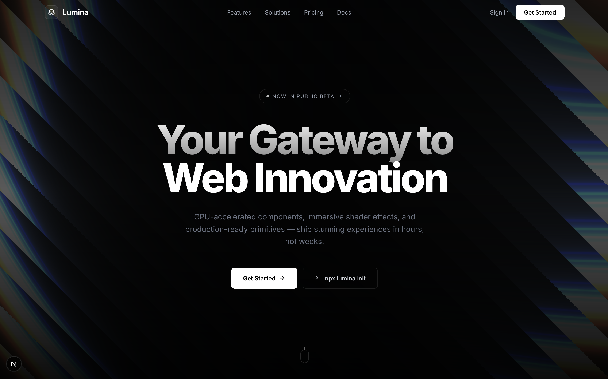
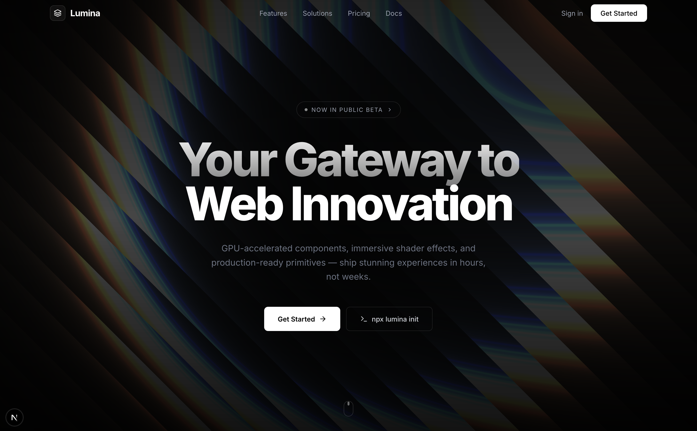
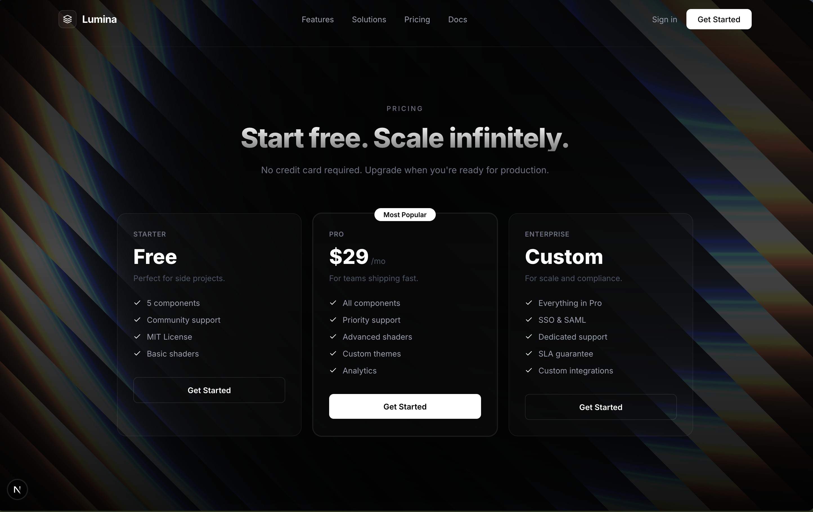
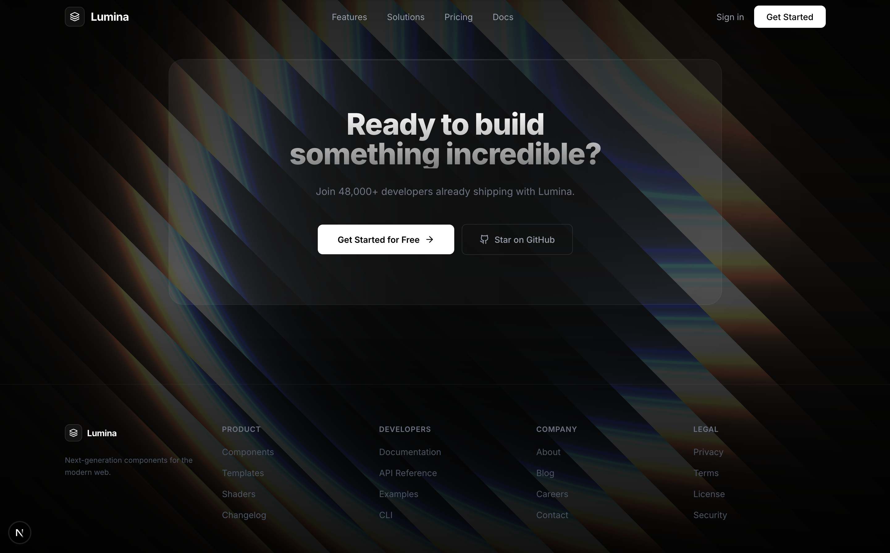

# Lumina — Premium Landing Page

A high-performance, GPU-accelerated landing page built with Next.js, Three.js, and Tailwind CSS. Features a real-time WebGL shader animation as the background with a premium black & white design.


## ✨ Features

- **GPU-Accelerated Shader Background** — Real-time WebGL shader animation powered by Three.js
- **Premium B&W Design** — Sophisticated monochrome aesthetic with glassmorphism effects
- **Fully Responsive** — Optimized for all screen sizes
- **Modular Architecture** — Clean component structure with separated layout, sections, and UI components
- **TypeScript** — Fully typed codebase
- **Performance Optimized** — Tree-shakable components and minimal bundle size

## 📸 Screenshots









## 🛠 Tech Stack

| Technology | Purpose |
|---|---|
| **Next.js 16** | React framework with App Router |
| **TypeScript** | Type safety |
| **Tailwind CSS** | Utility-first styling |
| **Three.js** | WebGL shader rendering |
| **Lucide React** | Icon library |

## 📁 Project Structure

```
app/
  page.tsx              # Main page composition
  layout.tsx            # Root layout
  globals.css           # Global styles & animations
components/
  layout/
    navbar.tsx           # Navigation bar
    footer.tsx           # Footer
  sections/
    hero.tsx             # Hero section
    features.tsx         # Feature cards grid
    showcase.tsx         # Two-column showcase with stats
    capabilities.tsx     # Capabilities section
    faq.tsx              # FAQ grid
    code-example.tsx     # Code example section
    pricing.tsx          # Pricing cards
    cta.tsx              # Call-to-action section
  ui/
    shader-animation.tsx # WebGL shader background
    pricing-card.tsx     # Reusable pricing card
```

## 🚀 Getting Started

### Prerequisites

- Node.js 18+
- npm or yarn

### Installation

```bash
git clone https://github.com/your-username/lumina-landing.git
cd lumina-landing
npm install
```

### Development

```bash
npm run dev
```

Open [http://localhost:3000](http://localhost:3000) in your browser.

### Production Build

```bash
npm run build
npm start
```

## 📄 License

MIT License

Copyright (c) 2026 Guilherme de Castro

Permission is hereby granted, free of charge, to any person obtaining a copy
of this software and associated documentation files (the "Software"), to deal
in the Software without restriction, including without limitation the rights
to use, copy, modify, merge, publish, distribute, sublicense, and/or sell
copies of the Software, and to permit persons to whom the Software is
furnished to do so, subject to the following conditions:

The above copyright notice and this permission notice shall be included in all
copies or substantial portions of the Software.

THE SOFTWARE IS PROVIDED "AS IS", WITHOUT WARRANTY OF ANY KIND, EXPRESS OR
IMPLIED, INCLUDING BUT NOT LIMITED TO THE WARRANTIES OF MERCHANTABILITY,
FITNESS FOR A PARTICULAR PURPOSE AND NONINFRINGEMENT. IN NO EVENT SHALL THE
AUTHORS OR COPYRIGHT HOLDERS BE LIABLE FOR ANY CLAIM, DAMAGES OR OTHER
LIABILITY, WHETHER IN AN ACTION OF CONTRACT, TORT OR OTHERWISE, ARISING FROM,
OUT OF OR IN CONNECTION WITH THE SOFTWARE OR THE USE OR OTHER DEALINGS IN THE
SOFTWARE.
